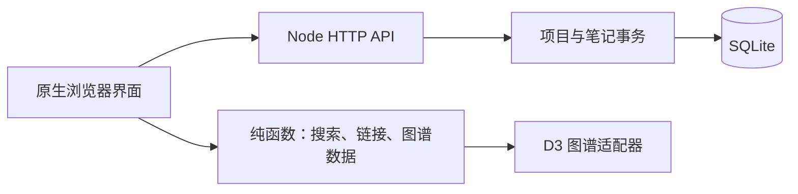

# 架构说明

浏览器通过同源 HTTP API 访问单进程 Node.js 服务，项目和笔记统一写入 SQLite。界面采用原生 HTML、CSS 与 ES 模块，无 React、Vue 或构建器；D3 仅承担图谱渲染。

| 位置 | 职责 |
| --- | --- |
| `public/js/app.js`、`views.js` | 页面状态、项目切换、编辑流程和视图 |
| `public/js/api.js` | 同源请求与错误处理 |
| `public/js/domain.js` | 标题与标签、搜索、双向链接、反向链接、图谱数据；供前后端复用 |
| `public/js/markdown.js` | 基础 Markdown 渲染、文本转义和链接协议校验 |
| `public/js/graph.js` | 唯一使用 D3 的模块；渲染、交互及卸载时资源释放 |
| `public/vendor/` | 固定版本 D3 与许可证 |
| `server/http.js` | API、来源校验、请求体限制、静态文件白名单及可选会话 |
| `server/store.js` | SQLite 表、校验、项目隔离和事务 |
| `server/seed.js`、`server/demos/` | 仅用于新数据库的三个演示项目 |

## 数据与一致性

项目包含名称、描述、颜色和时间；笔记包含项目 ID、标题、Markdown 正文、标签、置顶状态、时间和版本号。标题在项目内经 Unicode NFKC、去除首尾空白和大小写归一化后必须唯一。

笔记修改必须携带读取时的版本号，旧版本返回 `409 VERSION_CONFLICT`。重命名在同一事务中更新本项目内的 wiki 引用，同时提升每篇受影响笔记的版本；行内代码与围栏代码中的示例不参与改写。删除项目只级联删除该项目的笔记。

数据库采用外键和 WAL。应用使用一个 Node 进程，数据文件通过 `DATA_DIR` 定位；浏览器内存只保存当前页面状态与未保存草稿，不使用 localStorage。页面载入、切换与保存时获取数据，其他页面的更改不通过实时通道推送。

## 接口与边界

`/api/projects` 提供项目列表和创建；`/api/projects/:id` 提供修改与删除；其 `/notes` 路径提供笔记列表、创建、修改与删除。`GET /api/export` 返回版本为 1 的全部项目和笔记 JSON。

默认公开读取和编辑，服务端无需配置密码。显式配置 `SITE_PASSWORD` 时才启用会话登录；密码不写入前端或数据库，会话为进程内的 HttpOnly、SameSite=Strict Cookie。状态修改请求要求同源，静态文件仅从 `public/` 白名单提供。

当前不包含账号权限、实时协同、导入、完整 CommonMark 解析或 Obsidian 插件系统。演示数据来源见 [来源记录](DEMO_SOURCES.md)。
